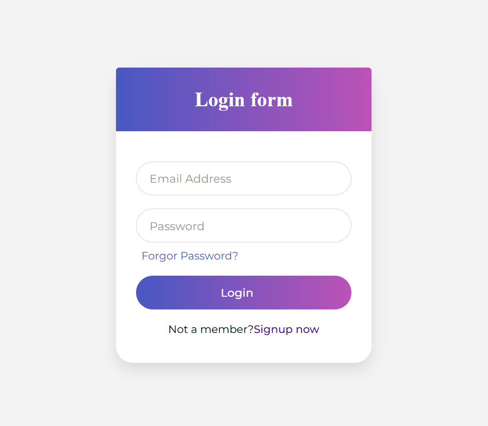
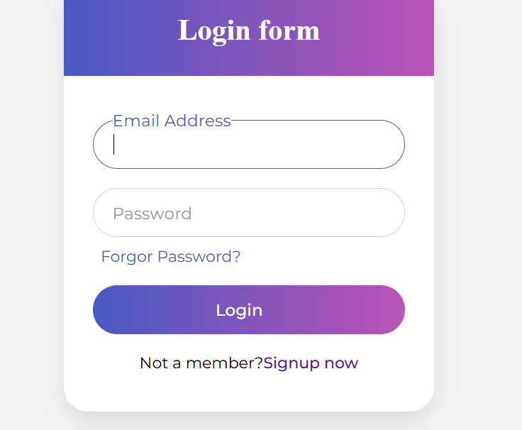

# Modern Login Form UI

A clean and modern login form built using HTML5 and CSS3. This project focuses on creating an attractive user interface with floating labels, gradient backgrounds, and smooth hover animations.

## Preview




## Features

- Floating labels using CSS `:focus` and `:valid` pseudo-classes.
- Custom animated underlines using `::after`.
- Gradient background and login button.
- Smooth transitions and hover effects.
- Rounded input fields.
- Responsive layout.

## Technologies Used

- HTML5
- CSS3
- Google Fonts

## CSS Concepts Practiced

- CSS Positioning (`relative` and `absolute`)
- Pseudo-classes (`:focus`, `:valid`, `:hover`, `:active`)
- Pseudo-elements (`::after`)
- General sibling combinator (`~`)
- CSS Transitions and Transforms
- Linear Gradients
- Box Model

## Getting Started

1. Clone this repository:
   ```bash
   git clone YOUR_REPOSITORY_URL
   ```
2. Open the project folder.
3. Open `index.html` in your browser.

## Future Improvements

- Add JavaScript form validation.
- Add show/hide password functionality.
- Improve mobile responsiveness.
- Add a registration page.

## Author

Md Junaid Arifin